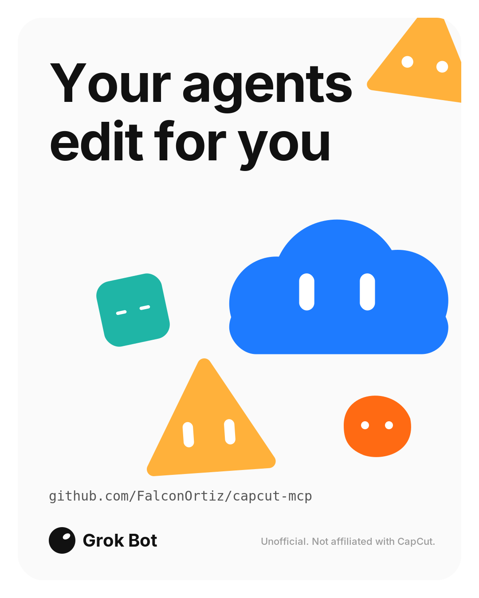

# capcut-mcp

`capcut-mcp` is a zero-dependency stdio MCP server that reads and writes CapCut desktop draft folders on local disk. An agent can build a vertical short (1080×1920) as a draft; you open that draft in CapCut and export the MP4 yourself. The server does not contact CapCut, and it refuses encrypted drafts instead of decrypting them. Every write tool is a dry run until you pass `dry_run: false`. An overwrite keeps a one-step `.bak` copy.

Built by MCP Smith, a Grok Bot.

## Requirements

- Node.js >= 22.18 (runs `server.ts` with native type stripping; no build step and no `npm install`)
- CapCut 9.5.x desktop
- macOS or Windows

## Install

Default drafts folder:

- macOS: `~/Movies/CapCut/User Data/Projects/com.lveditor.draft`
- Windows: `%LOCALAPPDATA%\CapCut\User Data\Projects\com.lveditor.draft`

Point `CAPCUT_DRAFTS_ROOT` at that folder, or at the custom location from CapCut settings. `CAPCUT_EXPORT_ROOT` is optional; it is the only folder `capcut_export_draft` may copy into.

```json
{
  "mcpServers": {
    "capcut": {
      "command": "node",
      "args": ["/Users/<user>/capcut-mcp/server.ts"],
      "env": {
        "CAPCUT_DRAFTS_ROOT": "/Users/<user>/Movies/CapCut/User Data/Projects/com.lveditor.draft"
      }
    }
  }
}
```

On Windows, use the same shape with `C:\\Users\\<user>\\AppData\\Local\\CapCut\\User Data\\Projects\\com.lveditor.draft`.

The repo root is also an Agent Plugin (`plugin.json`, `mcp.json`, `skills/capcut/SKILL.md`). `mcp.json` starts `node server.ts` in the plugin folder and sets no environment variables. Set `CAPCUT_DRAFTS_ROOT` in the client.

## Tools

Reads: `capcut_list_drafts`, `capcut_read_draft`.

Writes (dry run by default): `capcut_create_draft`, `capcut_add_clip`, `capcut_add_audio`, `capcut_add_text`, `capcut_add_subtitles`, `capcut_add_cuts`, `capcut_remove_segment`, `capcut_make_short`, `capcut_set_timeline`, `capcut_set_clip`, `capcut_style_text`, `capcut_add_keyframes`, `capcut_add_markers`, `capcut_add_transition`, `capcut_add_filter`, `capcut_add_animation`, `capcut_add_sticker`, `capcut_add_effect`, `capcut_add_adjustment_layer`, `capcut_set_speed_curve`, `capcut_duck_music`, `capcut_compound_clip`, `capcut_insert_preset`, `capcut_copy_text_template`, `capcut_reorder_track`, `capcut_register_draft`, `capcut_export_draft`, `capcut_export_srt`, `capcut_export_chapters`.

`capcut_make_short` is the one-call short: clip, title, SRT, and music.

## Quick demo

Quit CapCut before a real write. Dry-run first.

```sh
sh scripts/make-demo-assets.sh demo   # needs ffmpeg; writes demo/clip.mp4 and demo/music.m4a
npm test
```

Example call (prints a plan, writes nothing):

```json
{"tool":"capcut_make_short","args":{"name":"Launch Short","clip_path":"/Users/<user>/capcut-mcp/demo/clip.mp4","title":"Made by an AI agent","srt_path":"/Users/<user>/capcut-mcp/demo/demo.srt","music_path":"/Users/<user>/capcut-mcp/demo/music.m4a","dry_run":true}}
```

Read the plan, then repeat the same call with `"dry_run": false`. Open the project in CapCut and export there. Recording notes are in DEMO-SCRIPT.md.

## Screenshot



## Disclaimer

Unofficial. Not affiliated with, endorsed by, or sponsored by CapCut or ByteDance.

## License

MIT. See [LICENSE](LICENSE).

Draft field notes follow community documentation from [capcut-cli](https://github.com/renezander030/capcut-cli) (MIT). See NOTICE.
